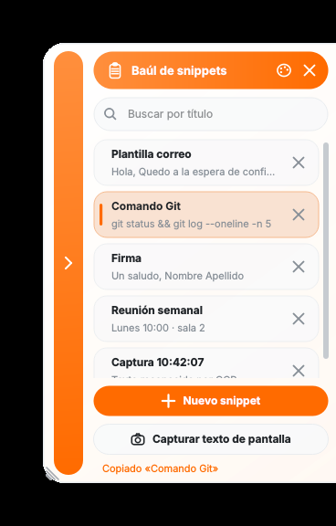
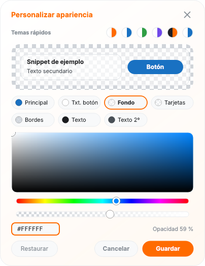

# Snippet Storage


-41CD52?logo=qt&logoColor=white)


Gestor de fragmentos de texto (*snippets*) que vive como una **barra lateral acoplable** al borde de la pantalla. Un clic copia el snippet al portapapeles, y un botón de **captura con OCR** convierte cualquier zona de la pantalla en un snippet nuevo. Funciona en segundo plano, con icono en la bandeja del sistema y sin ocupar sitio en la barra de tareas.

<p align="center">
  
  &nbsp;&nbsp;
  
</p>

## Características

- **Barra lateral acoplable** a cualquiera de los cuatro bordes y en cualquier monitor; se arrastra desde su raíl y recuerda su posición.
- **Copia con un clic**, edición con doble clic y borrado con confirmación.
- **Búsqueda instantánea** por título.
- **Captura de texto con OCR** de cualquier zona de la pantalla (multimonitor), procesada en segundo plano para no bloquear la interfaz.
- **Personalización completa**: seis temas rápidos, selector de color integrado y **transparencia ajustable** en fondo, tarjetas, bordes y color principal.
- **Tamaño ajustable** arrastrando el tirador de la esquina del panel (se guarda y se limita al monitor).
- **Segundo plano**: icono en la bandeja del sistema, sin botón en la barra de tareas, instancia única e inicio opcional con Windows.
- **Datos locales** en un único `snippets.json`; sin conexión ni telemetría.
- **Registro de errores** (`snippet_manager_errors.log`) que incluye excepciones y avisos internos de Qt para diagnosticar cierres inesperados.

## Instalación

### Opción A · Ejecutable (recomendada)

1. Descarga `SnippetBaul.zip` desde la sección **Releases** y descomprímelo en una carpeta estable (por ejemplo, `C:\Program Files\SnippetBaul` o `%LOCALAPPDATA%\Programs\SnippetBaul`).
2. Ejecuta `SnippetBaul.exe`. Aparecerá la pestaña en el borde de la pantalla y el icono en la bandeja del sistema.

> Si tu equipo es corporativo y Windows bloquea la ejecución, consulta [Entornos corporativos](#entornos-corporativos).

### Opción B · Desde el código fuente

Requiere Python 3.10 o superior y [Tesseract-OCR](https://github.com/UB-Mannheim/tesseract/wiki) instalado en el sistema (en Windows, marca **Spanish** al elegir los idiomas).

```bash
git clone https://github.com/adriancascudo/AeroClipboard
cd snippet-baul
python -m venv .venv
.venv\Scripts\activate          # Linux/macOS: source .venv/bin/activate
pip install -r requirements.txt
pythonw snippet_manager.pyw     # o "python snippet_manager.pyw" para ver la consola
```

El módulo de OCR (`text_from_image.py`) debe estar en la misma carpeta que `snippet_manager.pyw`. Busca Tesseract en el `PATH` y en las rutas habituales de instalación. Si falta o no se puede importar, la aplicación arranca igualmente y avisa al intentar capturar texto.

> El OCR usa los idiomas `spa+eng` (constante `IDIOMAS_OCR`). Sin `spa.traineddata` el texto se reconoce, pero se pierden tildes y eñes.

## Uso

| Acción | Cómo |
| --- | --- |
| Abrir / cerrar el panel | Clic en la pestaña del borde (o en el raíl lateral del panel) |
| Mover la barra | Arrastrar la pestaña o el raíl hacia otro borde o monitor |
| Copiar un snippet | Clic sobre la tarjeta |
| Editar un snippet | Doble clic sobre la tarjeta |
| Eliminar un snippet | Botón ✕ o clic derecho (pide confirmación) |
| Guardar en el editor | `Ctrl + Enter` |
| Cancelar / limpiar búsqueda | `Esc` |
| Capturar texto de pantalla | Botón **Capturar texto de pantalla**, arrastrar para seleccionar, `Esc` cancela |
| Cambiar el tamaño | Arrastrar el tirador diagonal de la esquina libre del panel |
| Colores y transparencias | Icono de paleta en la cabecera |

### Bandeja del sistema

El menú del icono de la bandeja permite abrir el panel, mostrar u ocultar por completo la pestaña (modo segundo plano), activar el **inicio con Windows**, abrir la carpeta de datos y salir. Un clic sobre el icono abre o pliega el panel.

Windows suele colocar los iconos nuevos en el desplegable `^` de la bandeja. Para dejarlo siempre visible, arrástralo a la zona principal.

### Argumentos

| Argumento | Efecto |
| --- | --- |
| `--hidden` | Arranca sin mostrar la pestaña; solo el icono de la bandeja (lo usa el inicio con Windows) |

Si se lanza una segunda copia, no se abre otra ventana: se muestra la que ya está en ejecución.

## Dónde se guardan los datos

| Modo | Ubicación de `snippets.json` y del registro |
| --- | --- |
| Código fuente | Carpeta del script |
| Ejecutable | `%APPDATA%\SnippetBaul\` |
| Portable | Junto al `.exe`, si ya existe allí un `snippets.json` |

Para usarlo como aplicación portable, copia un `snippets.json` (aunque sea `{"snippets": {}}`) junto a `SnippetBaul.exe`. Si el archivo está dañado, se conserva como `snippets.json.bak` en lugar de sobrescribirse.

## Compilar el ejecutable

El proyecto se empaqueta con [PyInstaller](https://pyinstaller.org) en modo **carpeta** (`--onedir`).

**Requisitos previos (solo en la máquina que compila):** Python 3.10+ y Tesseract-OCR con el idioma Spanish, instalado en `C:\Program Files\Tesseract-OCR` (o define `TESSERACT_DIR` con otra ruta). Desde la raíz del repositorio:

```bat
build.bat
```

El script crea un entorno virtual, instala las dependencias, **copia a `vendor\tesseract` solo lo necesario de Tesseract** (ejecutable, DLL, `eng` y `spa`) y lo incluye en el paquete, de modo que **quien use el `.exe` no necesita instalar Tesseract**. Después compila y genera:

- `dist\SnippetBaul\SnippetBaul.exe` (junto a su carpeta `_internal`)
- `dist\SnippetBaul.zip`, listo para distribuir
- el hash SHA-256 del ejecutable, necesario si TI debe permitirlo por huella

Decisiones de compilación y por qué:

- **`--onedir` en vez de `--onefile`**: el modo de un solo archivo se descomprime en `%TEMP%` en cada arranque, justo el comportamiento que antivirus y políticas de ejecución bloquean con más frecuencia.
- **`--noupx`**: los ejecutables comprimidos con UPX provocan falsos positivos.
- **`--windowed`**: sin ventana de consola.
- **Metadatos e icono** (`version_info.txt`, `assets/icon.ico`): un ejecutable identificado es menos sospechoso para los motores de reputación. Edita `CompanyName` y `LegalCopyright` antes de distribuir.

En tiempo de ejecución, `text_from_image.py` busca primero el Tesseract incluido en el paquete (carpeta `tesseract` junto al ejecutable) y, si no existe, el instalado en el sistema. Para añadir más idiomas, copia sus `.traineddata` a `vendor\tesseract\tessdata` o ajusta las líneas `copy` de `build.bat`. Tesseract se distribuye bajo licencia Apache 2.0; `build.bat` incluye su archivo de licencia en el paquete.

<details>
<summary>Alternativa: Nuitka</summary>

Nuitka traduce el código a C y suele generar menos falsos positivos. Requiere un compilador de C (MSVC o MinGW):

```bat
pip install nuitka
python -m nuitka --standalone --enable-plugin=pyside6 --windows-console-mode=disable ^
    --windows-icon-from-ico=assets\icon.ico --output-dir=dist snippet_manager.pyw
```

</details>

## Entornos corporativos

Si Windows cierra o impide ejecutar la aplicación en un equipo gestionado, la causa casi siempre es una directiva de la organización, no un fallo del programa. Las más habituales:

- **AppLocker / App Control for Business (WDAC)**: por defecto solo permiten ejecutar desde `Program Files` y `Windows`. Los ejecutables en `Descargas`, `Escritorio` o `%LOCALAPPDATA%` se bloquean.
- **Reglas ASR de Microsoft Defender** (por ejemplo, bloquear ejecutables poco habituales o sin prestigio) y **SmartScreen**.

La vía correcta es pedir a TI que lo autorice, y estas medidas lo facilitan:

1. **Firma el ejecutable** con un certificado de firma de código de la empresa (o de una CA de confianza):

   ```bat
   set SIGN_THUMBPRINT=<huella-del-certificado>
   build.bat
   ```

   Con una firma, TI puede permitir la aplicación por **editor** en lugar de por archivo, y las actualizaciones siguen funcionando. Una firma autofirmada solo sirve si TI la distribuye como certificado de confianza.
2. **Facilita el hash SHA-256** que imprime `build.bat` y la ruta de instalación prevista, para una regla por huella o ruta.
3. **Instala en una ruta permitida** (normalmente `C:\Program Files\...`).
4. Si Defender marca el archivo como falso positivo, envíalo a Microsoft desde el [portal de envío de análisis](https://www.microsoft.com/wdsi/filesubmission).
5. El inicio con Windows usa solo la clave `HKCU\...\Run` del usuario y **no requiere permisos de administrador**.

Esta aplicación no necesita privilegios elevados, no accede a la red y solo escribe en su carpeta de datos.

## Solución de problemas

- **La aplicación se cierra sin mensaje**: revisa `snippet_manager_errors.log` en la carpeta de datos; contiene excepciones, avisos de Qt y volcados de caídas nativas. Adjúntalo al abrir una incidencia.
- **No veo el icono de la bandeja**: está en el desplegable `^`. Si el sistema no dispone de bandeja, la ventana se muestra siempre, aunque se use `--hidden`.
- **El OCR no responde o falla**: la app muestra el motivo. Comprueba que Tesseract está instalado (código fuente) o que `build.bat` terminó sin errores (ejecutable).
- **Se pierden tildes y eñes**: falta `spa.traineddata`; reinstala Tesseract marcando Spanish.
- **La pestaña ha desaparecido**: usa **Mostrar / ocultar pestaña** en el menú de la bandeja, o lanza de nuevo la aplicación para que reaparezca.

## Estructura del proyecto

```
snippet-baul/
├── snippet_manager.pyw   # Aplicación completa (interfaz, temas, captura, bandeja)
├── text_from_image.py    # Módulo de OCR (Tesseract + OpenCV)
├── requirements.txt
├── build.bat             # Compilación a ejecutable (incluye Tesseract)
├── version_info.txt      # Metadatos del .exe
├── assets/               # Icono de la aplicación
└── docs/                 # Capturas para este README
```

## Contribuir

Las incidencias y las *pull requests* son bienvenidas. Antes de proponer un cambio, ejecuta la aplicación desde el código fuente y confirma que el registro de errores queda vacío tras probar tus modificaciones.

## Licencia

Distribuido bajo licencia MIT. Consulta [`LICENSE`](LICENSE).
